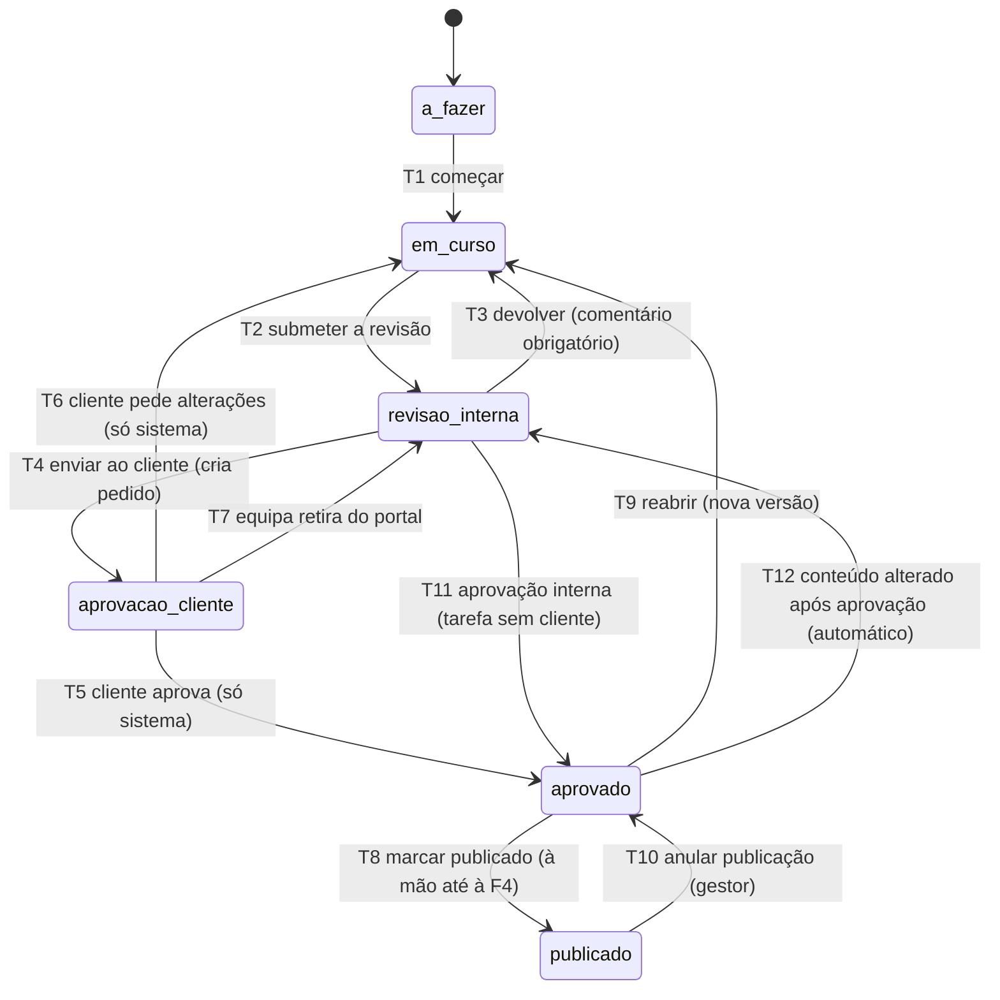

# Do It On Studio: análise técnica

| | |
|---|---|
| Estado | Proposta para validação. Nenhum código de produto foi escrito e nenhuma infra-estrutura foi criada ou instalada. |
| Data | 29 de Outubro de 2026 |
| Âmbito | Primeira tarefa definida em `CLAUDE.md`: seis partes, da leitura dos documentos ao plano da parte A, e a lista final de perguntas. |
| Convenção | Cada afirmação que depende de documentação ou de versão leva uma referência `[F#]`, listada na secção "Fontes". Quando a afirmação é conhecimento meu e não foi verificada nesta sessão, diz-se "a confirmar". Quando é um juízo meu, diz-se "recomendação" ou "estimativa". |
| Ortografia | Segue a do documento fonte de verdade (`activo`, `projecto`, `arquitectura`). A pergunta 8 pede a decisão. |

## Índice

0. [Resumo](#0-resumo)
1. [Leitura dos documentos, dúvidas e contradições](#1-leitura-dos-documentos-dúvidas-e-contradições)
2. [Verificação da stack](#2-verificação-da-stack)
3. [Modelo de dados, RLS e testes de isolamento](#3-modelo-de-dados-rls-e-testes-de-isolamento)
4. [Quadro kanban ligado à aprovação](#4-quadro-kanban-ligado-à-aprovação)
5. [Estimativa de esforço, riscos e decisões prévias](#5-estimativa-de-esforço-riscos-e-decisões-prévias)
6. [Plano da parte A em tarefas pequenas](#6-plano-da-parte-a-em-tarefas-pequenas)
7. [Perguntas para quem encomenda](#7-perguntas-para-quem-encomenda)
8. [Fontes](#8-fontes)

---

## 0. Resumo

**A stack decidida aguenta o desenho.** Não encontrei nenhum motivo técnico para reabrir NestJS, Prisma, PostgreSQL com RLS, Tiptap com Yjs, BullMQ ou Chromium. Encontrei, sim, onze pontos de atrito que o desenho tem de tratar desde a primeira migração (secção 2) e 25 dúvidas e contradições, das quais seis mudam o desenho e precisam de decisão (D1, D6, D8, D9, D10 e D13, na secção 1.3).

**As sete conclusões que mais pesam:**

1. **O Prisma não aplica RLS sozinho.** A extensão de cliente que chama um método ao nível do cliente, dentro de uma transacção, executa as consultas noutra ligação e ignora a transacção [F5]. A solução proposta é abrir uma transacção interactiva por pedido, fixar o contexto com `set_config(..., true)` e `SET LOCAL ROLE` na primeira instrução, e só deixar o código aceder à base de dados através desse contexto (secção 3.3).
2. **A regra "toda a tabela leva o identificador do cliente" não se cumpre à letra.** Utilizadores da equipa, receitas de instrução, catálogo de KPIs e modelos pertencem à agência. Proponho duas classes de tabelas: *dados de cliente* (com `client_account_id`, RLS e chave estrangeira composta) e *dados de agência* (RLS visível só à equipa). Como a Do It On é uma única agência, não há `agency_id` em lado nenhum (secção 3.1).
3. **"Permissões herdadas pela pasta" expõe material interno ao cliente** se for aplicada sem mais, porque a pasta partilhada contém tarefas, notas e rascunhos. É preciso uma camada de visibilidade (`internal` por omissão, `client` só quando se publica), que a maquete não mostra (secção 3.3).
4. **A maquete mostra mais do que a fase 1 promete.** O portal tem indicadores e barras PESO (fase 4), o editor tem "Variante por canal" (fase 4) e o quadro kanban é da fase 2. Proponho cortar a maquete por fase em vez de construir para o ecrã (secção 1.4).
5. **O Prisma `latest` no registo npm é um candidato a lançamento** (`8.0.0-rc.28`), e a versão estável é a `7.10.1` (etiqueta `prev`) [F2, F6]. Um `pnpm add prisma` sem versão fixa instala o candidato. Proponho fixar versões exactas e decidir Node, Prisma e NestJS numa tarefa de validação (A1.5), antes de qualquer outra.
6. **O Tiptap é gratuito; o histórico de versões da Tiptap, ao que tudo indica, não.** A comparação pública da Tiptap põe "Comments & Document History" na coluna da plataforma paga [F8]. O histórico de versões do conteúdo será construído por nós, a partir de instantâneos do documento (secção 2.3).
7. **O desenho de servidor único é o maior risco operacional.** PostgreSQL, Redis, API, WebSocket de edição, Chromium, FFmpeg e trabalhadores partilham uma só máquina. Sem preço, dimensionamento nem confirmação do PostgreSQL por parte da HawkHost, a parte A só pode ser testada localmente (secção 5.2).

**Esforço (estimativa de ordem de grandeza, ±40%):** parte A 36 a 53 dias-pessoa, parte B 71 a 109, fase 2 72 a 117, fase 3 49 a 77, fase 4 85 a 142. Total entre 313 e 498 dias-pessoa (secção 5.1). A parte A serve para calibrar o resto.

**O que preciso de si antes de a parte A começar** está na secção 5.3 e, com recomendação por pergunta, na secção 7. As cinco perguntas que bloqueiam o primeiro dia são: servidor (preço e PostgreSQL), registo no Entra ID, domínio e canal de e-mail, primeiro factor de início de sessão do cliente, e a decisão sobre as versões de Node, Prisma e NestJS.

---

## 1. Leitura dos documentos, dúvidas e contradições

### 1.1 O que li

| Documento | Versão lida | Notas |
|---|---|---|
| `CLAUDE_dionstudio.md` (instruções) | ficheiro carregado nesta sessão | 129 linhas |
| Fonte de verdade: "Do It On Studio: produto, arquitectura e plano de construção" | revisão 189 de 28/10/2026, autor Fernando Batista | 595 linhas depois de convertida para texto; li-a por inteiro [F13] |
| Maquete dos ecrãs principais (`claude.ai/artifact/UroJrwgB9gMpbSkJ7NSAWq`) | versão `1793235522-a609` | cinco ecrãs: Campanhas, Kanban, Pasta, Activos, Portal; li o código de cada um [F13] |
| Sistema de design "Do It On Design System" | versão `1793123071-7c2f`; `tokens.json` com SHA-256 `74eca035…15f5a` | li o `README.md` e o `tokens.json` completos; não abri os restantes 85 ficheiros (componentes, diapositivos, kit de interface) [F13] |

O link que enviou duas vezes é o da maquete. Não alterei nenhum dos artefactos.

### 1.2 Divergências entre `CLAUDE.md` e a fonte de verdade

`CLAUDE.md` diz que, em caso de divergência, ganha o documento fonte, e que a divergência se comunica. Comparei os dois linha a linha: **não há divergência material**. Há duas diferenças de forma:

- O título da fase 2 em `CLAUDE.md` é "planeamento, aprovação e impressão"; no documento fonte é "Planeamento, equipa, aprovação e impressão". O conteúdo é o mesmo (a alocação da equipa consta de ambos). Ganha o documento fonte.
- `CLAUDE.md` numera as fases como itens 1 a 5 da lista, o que faz de "Fase 3" o item 4. Neste documento uso **A, B, F2, F3 e F4** para evitar a confusão.

### 1.3 Contradições e dúvidas

A coluna "Bloqueia" diz quando a resposta é precisa: **A** (antes da parte A), **B** (antes da parte B), **F2** ou **F3**. A proposta de resolução é o que farei se não houver indicação em contrário.

| # | Onde | Problema | Proposta de resolução | Bloqueia |
|---|---|---|---|---|
| D1 | Regra 1 ("toda a tabela leva o identificador do cliente") e modelo de dados | Utilizador da equipa, receita de instrução (partilhada por toda a agência), catálogo de KPIs padrão, modelos de plano e ligação de IA "por agência" não pertencem a nenhuma conta de cliente. A regra, lida à letra, é impossível. | Duas classes. **Tabelas de cliente**: `client_account_id NOT NULL`, RLS, chave estrangeira composta. **Tabelas de agência**: RLS que só admite a equipa; o portal não tem sequer `GRANT`. Toda a tabela tem RLS, sem excepção; o teste de catálogo (secção 3.4) falha se aparecer uma tabela sem RLS. | A |
| D2 | Modelo de dados: "Agência e conta de cliente (tenant)" | Com uma só agência, um `agency_id` em todas as tabelas é peso sem função. | Não existe `agency_id`. A "agência" é configuração (`agency_settings`, uma linha). O único tenant é a conta de cliente. | A |
| D3 | Modelo de dados: "Bloco" como entidade com versões | No editor Tiptap, os blocos são nós do documento, não linhas de uma tabela. Uma tabela `block` obrigaria a sincronizar duas fontes de verdade. | Os blocos vivem em `content_item.document` (JSONB, formato ProseMirror) com um `blockId` estável por nó. A versão é do documento inteiro. Uma tabela de ligação `content_item_asset`, derivada ao gravar, mantém a integridade referencial dos activos usados. | B |
| D4 | Maquete "Campanhas 14, Projectos 6, Temas 9" e modelo | "Projecto" não existe no modelo de dados; a pasta de história é "campanha ou medida". | A pasta tem `kind` (`campaign`, `project`, `workspace`) e `parent_id`. Um projecto é uma pasta de outro tipo, não uma tabela nova. A palavra "medida" fica fora da interface, salvo indicação. | A |
| D5 | Tema: "atravessa campanhas e projectos", filtrável por cliente | Se o tema for global, é uma tabela partilhada entre clientes (fuga de nomes de tema, conflito com a regra 1). | Tema por conta de cliente. A equipa pode criar temas a partir de um modelo da agência, que é copiado. Mesma etiqueta em dois clientes são duas linhas. | B |
| D6 | Regra 3 ("permissões herdadas por tudo o que a pasta contém") e regra 2 ("o cliente nunca vê material interno") | Tarefas, notas de equipa, rascunhos e a maquete "Em anexo nesta pasta: 2 actividades no quadro" vivem na pasta partilhada. Herança pura expõe tudo. | A herança dá **acesso à pasta**; a **visibilidade** de cada objecto é uma segunda condição. Todo o objecto nasce `internal`; o cliente só vê o que for `client` ou fizer parte de um pedido de aprovação (secção 3.3). | A |
| D7 | Herança | Não está dito se uma subpasta pode **cortar** a herança. | Só concessões aditivas na parte A. Material sensível fica fora da pasta partilhada. Revisitar se o uso real o pedir. | A |
| D8 | Unidade de aprovação | O portal aprova "Dossiê de lançamento" (comunicado, mensagens-chave, 3 imagens); a fase 3 fala em aprovar "um briefing" e na "pasta aprovada"; a versão aprovada pertence a um item. Não é claro se se aprova um item, uma pasta ou um conjunto. | Entidade `approval_request` ("dossiê"): um conjunto de pares *(item, versão congelada)* e de activos, com `scope` (`briefing`, `dossier`, …), enviada por uma pessoa, decidida por um cliente. A versão aprovada fica marcada (a maquete mostra-o). | A (desenho), B (uso) |
| D9 | Estado da pasta vs. "Iniciar produção" (F3) | A maquete mostra estados de pasta (Em curso, Revisão interna, Em aprovação do cliente, Aprovado, Publicado). A fase 3 diz que, ao aprovar o briefing, "a pasta passa a Aprovado". Mas "Aprovado" de uma pasta com tarefas por fazer significaria o contrário. | O botão "Iniciar produção" depende de existir um `approval_request` aprovado com `scope = briefing`, não do estado da pasta. O estado da pasta é a síntese do trabalho (secção 4.5). | F3 |
| D10 | Fase B vs. maquete do portal | A fase B promete "o PDF em PESO, publicado sem automação". O ecrã do portal mostra cartões de KPI, barras PESO e um selector de indicadores (fase 4). | Na parte B, o portal lista relatórios e abre o PDF. A vista estruturada e o catálogo de indicadores ficam para a fase 4. | B |
| D11 | Maquete do editor: botão "Variante por canal" | Variantes por canal são da fase 4. | Não existe na parte B. | B |
| D12 | Maquete do quadro kanban | O quadro é da fase 2, mas o estado "Em aprovação" já é preciso na parte B. | Na parte B há um estado de pasta e um pedido de aprovação. O quadro e a tarefa chegam na F2 e reutilizam o pedido de aprovação (secção 4). | B |
| D13 | Edição simultânea na parte B | A lista da parte B diz "editor por blocos com histórico de versões" e não menciona trabalho simultâneo. A stack inclui Yjs. Acrescentar Yjs depois muda o formato de persistência. | Yjs desde o primeiro dia do editor. É mais barato do que migrar. Confirmar (pergunta 16). | B |
| D14 | "Cada gravação gera uma versão numerada" | Com Yjs não há "gravar". | A versão é um instantâneo (JSON do documento) criado em eventos: enviar para revisão, enviar ao cliente, aprovação, "guardar versão" manual e inactividade prolongada. Restaurar cria uma versão nova; não reescreve a história. | B |
| D15 | Instalação do PostgreSQL | O documento fonte diz "PostgreSQL instalado no Cloud Compute" e também "contentores com Docker Compose". | Recomendação: PostgreSQL em contentor no mesmo Compose, com volume no disco do servidor e arquivo de WAL para fora. Igual em desenvolvimento e em produção. Decidir em A1.3. | A |
| D16 | Autenticação do cliente | O convite envia uma ligação; a autenticação em dois passos é opcional. Não está definido o **primeiro** factor depois do convite. | Recomendação: ligação de uso único enviada por e-mail em cada início de sessão (sem palavra-passe a gerir), com TOTP opcional por cima. Alternativa: palavra-passe. Ver pergunta 6. | A |
| D17 | Papéis | O modelo lista "editor, revisor, freelancer, convidado". Não há papéis do lado do cliente (aprovador? leitor?). Freelancers não têm conta Entra. | Proposta na secção 3.3: níveis de concessão `view`, `comment`, `edit`, `approve`, `manage`. Freelancers entram por convite, como clientes, mas com `kind = staff`. | A |
| D18 | Envio de e-mail | Convites, notificações e relatórios dependem de e-mail. Nenhum documento diz **por onde** se envia. | Recomendação: Microsoft Graph (`sendMail`) a partir de uma caixa partilhada, porque o cliente Graph e o OAuth já existem. Alternativa: SMTP transaccional na UE. Depende do domínio (SPF, DKIM, DMARC). Pergunta 5. | A |
| D19 | Registo de consultas e histórico de alterações | O período de 12 meses e a regra de "só acréscimo" estão definidos para o registo de consultas. Nada se diz sobre a retenção do **histórico de alterações** (base da reversão). | São dois registos com volumes e retenções diferentes. O histórico de alterações não expira por omissão; a retenção por conta de cliente (útil, sem fase) decide depois. | B |
| D20 | Ortografia | O documento fonte usa a ortografia anterior ao Acordo (`activo`, `projecto`, `óptica`); `CLAUDE.md` escreve `seletor`. | Escolher uma e fixá-la no glossário de tradução. Pergunta 8. | A |
| D21 | Idiomas EN, ES, FR | Não está dito quem traduz nem quem revê. | A equipa fornece ou revê; eu produzo o rascunho. Chaves em falta falham a integração contínua. Pergunta 8. | B |
| D22 | Azure AD | Chama-se Microsoft Entra ID desde 2023. | Usar "Entra ID" na documentação e na interface. | A |
| D23 | Londres "fora da UE" | O documento pede validação jurídica. Há um facto novo: a Comissão Europeia renovou, a 19 de Dezembro de 2025, as decisões de adequação para o Reino Unido, até 27 de Dezembro de 2031 [F12]. | Fica a ser um ponto jurídico, mas com a adequação em vigor. Falta o contrato e o acordo de tratamento de dados com a HawkHost (pergunta 3). | A |
| D24 | Fontes da interface | A maquete carrega o Comfortaa a partir do Google Fonts. | Auto-alojar (licença OFL-1.1 [F14]). Pedir tipos de letra a terceiros transmite o endereço IP do visitante; há jurisprudência alemã sobre o tema (a confirmar com apoio jurídico). | A |
| D25 | Ícones | O README do sistema de design indica Lucide por `unpkg.com/lucide@latest` (versão não fixa, terceiros em tempo de execução). | Pacote npm fixado e incluído na compilação. | A |

**O que a maquete deixa sem ecrã e a aplicação precisa:** início de sessão e convite, aceitação do convite com selector de idioma, partilha de pasta com cliente, histórico de alterações, importação com pré-visualização, configuração de 2FA, registo de consultas por item, administração de contas de cliente. Proponho desenhá-los na parte A e B com os mesmos tokens, sem nova maquete.

### 1.4 Maquete cortada por fase

| Ecrã | Parte A | Parte B | F2 | F3 / F4 |
|---|---|---|---|---|
| 1. Campanhas, projectos, temas | Lista simples de pastas por conta | **Aqui entra**: três separadores, filtros por cliente, estado e tema | Prazo e responsável vêm das tarefas | |
| 2. Quadro kanban | | Não | **Aqui entra** | |
| 3. Pasta de história | Árvore, partilha, histórico de alterações | **Editor, histórico de versões, comparar e restaurar**, "Enviar ao cliente" | "Enviar para revisão" (estado de tarefa) | "Variante por canal" (F4) |
| 4. Biblioteca de activos | | **Aqui entra** | Etiquetagem automática (F4) | |
| 5. Portal do cliente | Ver pastas partilhadas | **Aprovar / pedir alterações, comentar, relatório em PDF, selector de idioma** | Aprovação por níveis | Cartões de KPI e barras PESO (F4) |

### 1.5 Sistema de design: achados

Os tokens do sistema de design são utilizáveis, mas a maquete **não os usa** e há contrastes que não cumprem a regra de 4,5 para 1. Medi os rácios WCAG com a fórmula de luminância relativa.

**Tokens (`tokens.json`, versão 1):** uma só paleta (`light`); escalas `pink`, `cyan`, `mint` e `neutral` de 50 a 900; tokens semânticos (`color-primary` = `pink-500`, `color-secondary` = `cyan-500`, `color-accent` = `mint-400`); `radius-xl` = 1 rem (16 px); `radius-full` = 9999 px; sombras, espaçamento, tamanhos e pesos. **Não tem tema escuro**, apesar de o README o mencionar, e **não traz ficheiros de tipo de letra** (`type.fonts` está vazio).

**Divergências entre a maquete e os tokens:**

| Na maquete | Nos tokens | Consequência |
|---|---|---|
| `#4A4B66` (texto secundário) | `neutral-700` é `#3B3D5C`; `neutral-500` é `#767896` | Valores copiados à mão, o que `CLAUDE.md` proíbe |
| `#7A1F63`, `#0A5F8C`, `#0B5B41` (texto sobre fundos tingidos) | `pink-700` `#6E175A`, `cyan-700` `#085B8A`, `mint-700` `#0E744F` | Substituir pelos tokens `*-700` |
| Fundo da página `#F7F7FA` | `bg-page` é `#FFFFFF`; `#F7F7FA` é `bg-surface` | Decidir qual é o fundo da página; `CLAUDE.md` diz `#F7F7FA` |

**Contrastes (WCAG 2.2, mínimo 4,5 para texto normal, 3 para texto grande e componentes):**

| Par | Rácio | Veredicto |
|---|---|---|
| Branco sobre rosa `#B03090` (botão primário) | 5,72 | Passa |
| Branco sobre azul `#1090D0` (botão secundário, `color-secondary-fg`) | **3,55** | **Falha para texto normal.** Usar `cyan-600` (`#0B75AE`, 5,04) para botões com texto |
| Branco sobre verde `#30C090` | **2,32** | Falha (já assinalado em `CLAUDE.md`) |
| Verde `mint-600` `#168F64` sobre branco | **4,08** | Falha como texto; usar `mint-700` (5,79) |
| Texto `fg-3` `#767896` sobre branco | **4,29** | Falha por pouco; sobre `#F7F7FA` desce a **4,01** |
| Bordas de campos `#D2D2DE` e `border-default` `#DCDCE8` sobre branco | 1,50 e 1,36 | Falha o mínimo de 3 para componentes de interface; o campo sem borda legível não se distingue |
| Texto `#131426` sobre `#F7F7FA` | 16,99 | Passa |

**Recomendação:** `packages/design-tokens` guarda o `tokens.json` **tal como foi publicado** (com a versão e o SHA-256 no cabeçalho do ficheiro) e um passo de compilação gera as variáveis CSS e o tema do Tailwind, se se vier a usar. Em cima dos tokens vive uma camada semântica nossa (`text-muted`, `border-input`, `button-secondary-bg`) que escolhe pares que passam. Alvo: WCAG 2.2 nível AA como meta de qualidade interna (pergunta 19). Os testes incluem verificação automática com axe.

---

## 2. Verificação da stack

### 2.1 Versões à data (29/10/2026)

Consultadas no registo npm com `npm view`, que só lê [F2]; o calendário do Node vem do ficheiro oficial do repositório `nodejs/Release` [F1].

| Peça | Versão corrente | Nota |
|---|---|---|
| Node.js | 26 passou a LTS a 28/10/2026 (fim de vida 30/04/2029); 24 em Active LTS desde 28/10/2025 (manutenção desde 20/10/2026, fim 30/04/2028); 22 em manutenção (fim 30/04/2027) [F1] | Recomendação em 2.2 |
| NestJS (`@nestjs/core`) | `latest` 12.3.2; `legacy` 11.2.8; exige Node ≥ 20 [F2] | A versão 12 é recente: validar ecossistema em A1.5 |
| Prisma | `latest` **8.0.0-rc.28** (candidato); `prev` **7.10.1**; Prisma 7 exige Node `^20.19 \|\| ^22.12 \|\| >=24` [F2]. A página de estado de lançamento do Prisma tem a versão 8 como candidata [F6] | **Fixar a 7.10.x**; reavaliar quando a 8 sair do estado de candidato |
| Hocuspocus (`@hocuspocus/server`) | 4.8.0, MIT, Node ≥ 22 [F2] | Impõe Node ≥ 22 |
| Tiptap (`@tiptap/core`) | 3.32.1, MIT [F2] | Só pacotes MIT |
| Yjs | 13.6.33 [F2] | |
| BullMQ | 6.5.1, MIT [F2] | |
| React / Vite | 19.3.1 / 8.3.5 (Vite exige Node `^20.19 \|\| >=22.12`) [F2] | |
| i18next | 26.5.11 [F2] | |
| SDK de IA da Vercel (`ai`) | 7.0.156 [F2] | Fase 3 |
| Playwright / Vitest | 1.64.1 / 5.0.5 [F2] | |
| mammoth / pdfjs-dist | 1.13.0 (BSD-2-Clause) / 6.4.299 (Apache-2.0) [F2] | |

### 2.2 Decisões de versão propostas

- **Node.** O Hocuspocus 4.8.0 exige Node ≥ 22, o que exclui o 20. Entre 24 e 26: a 26 acabou de entrar em LTS e dura até 2029; a 24 já está provada pelo ecossistema, mas termina em Abril de 2028. **Recomendação:** tentar a 26 em A1.5 (instalar, compilar, correr o teste de fumo com Prisma, NestJS, Hocuspocus e Playwright); se algo falhar, usar a 24 e subir antes da F2. Em qualquer caso, `engines` e `.nvmrc` fixam a versão.
- **Prisma.** Fixar `7.10.x` com versões exactas (sem `^`). O Prisma 7 usa `prisma.config.ts` para o esquema, as migrações e o URL da base de dados [F5]. Se o adaptador de ligação à base de dados é obrigatório nesta linha, é coisa que A1.5 confirma. A migração para 8 é uma tarefa própria, depois de a 8 ser estável.
- **NestJS.** A versão 12 é a corrente. Se A1.5 mostrar incompatibilidades nos módulos de que precisamos (configuração, validação, filas), a alternativa é a linha 11.
- **Regra geral:** `pnpm install --frozen-lockfile` em CI, `save-exact=true`, e um passo de verificação de licenças que falha se aparecer um pacote que não seja MIT, BSD, Apache-2.0 ou ISC (excepções por escrito).

### 2.3 NestJS, Prisma, RLS no PostgreSQL e JSONB: pontos de atrito

**Resumo:** o PostgreSQL faz a parte difícil; o trabalho é garantir que **cada consulta corre numa transacção com o contexto certo**, que a aplicação **nunca** liga como papel que contorne o RLS, e que o RLS **tem testes que falham quando alguém o esquece**.

| # | Atrito | Fonte | Como se trata |
|---|---|---|---|
| T1 | O Prisma não tem suporte nativo para variáveis de sessão por pedido. Uma extensão que chame um método do cliente dentro de uma transacção emite as consultas **noutra ligação** e ignora a transacção [F5]. | Documentação do Prisma, extensões partilhadas | Não usar extensões para fixar o contexto. Usar uma transacção interactiva por pedido (`prisma.$transaction(async tx => …)`), com `set_config` e `SET LOCAL ROLE` na primeira instrução e `AsyncLocalStorage` a transportar o `tx` (secção 3.3). |
| T2 | Transacções interactivas têm limite: `maxWait` 2000 ms e `timeout` 5000 ms por omissão [F5]. | Documentação do Prisma, transacções | Pedidos curtos usam a transacção do contexto. Trabalhos longos (importação, relatório, PDF) **não** seguram uma transacção: dividem-se em passos curtos, cada um com o seu contexto. Valores explícitos por tipo de pedido. |
| T3 | Se o papel de ligação for superutilizador, tiver `BYPASSRLS` ou for o dono da tabela, o RLS não se aplica. O dono só fica sujeito com `FORCE ROW LEVEL SECURITY` [F3, F4]. | PostgreSQL, secção 5.9 | Três papéis separados: dono (só migrações, fora do tempo de execução), ligação da aplicação (`NOSUPERUSER NOBYPASSRLS`, sem `CREATE`) e papéis de função (`app_staff`, `app_portal`, …). `FORCE` em todas as tabelas. Teste de catálogo verifica-o. |
| T4 | Sem políticas, a tabela nega tudo (política por omissão "negar") [F3]. Operações de tabela inteira, como `TRUNCATE` e `REFERENCES`, não estão sujeitas ao RLS [F3]. | PostgreSQL, secção 5.9 | A omissão negar é o comportamento desejado. Sem `GRANT TRUNCATE` aos papéis de execução. |
| T5 | As verificações de chave estrangeira não passam pelo RLS (a confirmar na secção 5.9 do PostgreSQL), pelo que uma inserção que aponte para um identificador de **outra conta** pode ter sucesso ou revelar, pelo erro, que o registo existe. | Conhecimento próprio, a confirmar | **Chaves estrangeiras compostas** `(client_account_id, parent_id)` que apontam para `UNIQUE (client_account_id, id)` na tabela pai. Um registo de uma conta não pode, ao nível da base de dados, referir outra. Também `UNIQUE` sempre por conta. |
| T6 | Vistas correm com os direitos do dono e ignoram o RLS, salvo `security_invoker = true` (PostgreSQL 15 ou superior). Vistas materializadas não aplicam RLS por utilizador. | Conhecimento próprio, a confirmar | Sem vistas materializadas de dados de cliente. Vistas só com `security_invoker`. Teste de catálogo lista vistas e verifica a opção. |
| T7 | O Prisma Migrate não modela políticas, papéis nem `GRANT`. `migrate dev --create-only` cria a migração sem a aplicar, para lhe juntar SQL à mão antes da primeira execução [F5]. | Documentação do Prisma | As políticas e os `GRANT` vivem em **migrações SQL novas**, revistas em PR e nunca editadas depois de aplicadas. `CLAUDE.md` diz "nunca alteradas à mão": interpreto como "nunca editar uma migração já aplicada", que é a prática normal (confirmar, pergunta 14). **A validar em A2.1:** que `migrate dev` e `migrate diff` não propõem apagar as políticas por não as conhecerem. |
| T8 | A documentação do Prisma mostra uma sintaxe `@@rls` / `policy_select` na "criação de contratos" [F5]. Parece pertencer à linha 8 ou a uma API nova e não está confirmada como estável. | Documentação do Prisma | Não depender dela. SQL em migrações. |
| T9 | Campos `Json` do Prisma são `JsonValue`: sem tipos, sem actualização parcial. | Conhecimento próprio | Validação com Zod em `packages/shared` em todas as fronteiras. Actualizações parciais por SQL cru dentro do contexto, só onde necessário. |
| T10 | Pesquisa de texto: o Prisma não modela `tsvector` nem índices GIN. | Conhecimento próprio, a confirmar | Coluna gerada e índice GIN criados em migração SQL; leitura por `$queryRaw` **dentro do contexto**. O PostgreSQL traz configurações de texto para português, inglês, espanhol e francês; a extensão `unaccent` ajuda a ignorar acentos. A configuração é escolhida pelo idioma do conteúdo. |
| T11 | Enumerações do PostgreSQL são incómodas de alterar. | Conhecimento próprio | `enum` nativo só para conjuntos fechados e estáveis (`kind`). Estados que podem mudar usam `text` com `CHECK`. |

**Desempenho do RLS (recomendação):** índices que começam por `client_account_id`; funções `app.*()` marcadas `STABLE`; as políticas chamam-nas dentro de `(SELECT …)` para o planeador as avaliar uma vez; verificação com `EXPLAIN` nos testes de aceitação de cada tabela com mais de 10 mil linhas esperadas. Não há dados de volume (pergunta 20).

**NestJS:** um módulo por capacidade, como pede `CLAUDE.md`. Para a parte A: `identity`, `tenancy` (contas de cliente e pertenças), `folders`, `audit` (histórico), `mail`, `health`, mais um módulo de infra `db` que é o **único** a importar o cliente Prisma. Uma regra de ESLint (restrição de importações) proíbe `@prisma/client` fora desse módulo; sem ela, alguém acaba por contornar o contexto.

### 2.4 Tiptap com Yjs

**Escolha e justificação.**

- *Tiptap* é uma camada sobre o ProseMirror, com esquema estrito, nós personalizáveis e licença MIT no núcleo (3.32.1) [F2]. O esquema valida o documento e dá um JSON estável, que serve de formato de versão e de destino da importação de Word e PDF.
- *Yjs* resolve a edição simultânea sem bloqueios e a recuperação de ligações. O *Hocuspocus* (MIT, 4.8.0) é o servidor de Yjs da mesma equipa do Tiptap [F2, F7], com `onAuthenticate`, `onLoadDocument`, `onStoreDocument`, a extensão `Database` (o código devolve e recebe o estado binário do Yjs e guarda-o onde quiser) e a extensão Redis para vários servidores [F7].
- *Alternativas consideradas* (Lexical, Slate, ProseMirror puro): não as avaliei em profundidade. Com a stack já decidida, a vantagem do Tiptap é o menor trabalho de integração com Yjs e Hocuspocus. Juízo meu.

**Atritos e como se tratam.**

| # | Atrito | Tratamento |
|---|---|---|
| E1 | O histórico de documentos e os comentários do Tiptap são da plataforma paga, segundo a comparação pública da Tiptap [F8]; os pacotes "Pro" exigem subscrição [F8]. | Só pacotes MIT, verificados no CI. Histórico de versões e comentários feitos por nós (D14, tabela `comment`). **Confirmar nos termos da Tiptap antes de adoptar qualquer extensão que não seja do núcleo.** |
| E2 | O Hocuspocus tem de aplicar as **mesmas** regras de acesso que a API. | `onAuthenticate` recebe um bilhete de curta duração emitido pela API para um item e um utilizador; `onLoadDocument` e `onStoreDocument` correm no mesmo contexto RLS (papel `app_staff` ou `app_portal`, conta fixada). O nome do documento é `item:<uuid>`; a conta vem da base de dados, não do nome. Um teste de isolamento cobre o WebSocket. |
| E3 | Persistência. | `content_document` guarda o estado binário do Yjs (`bytea`) e uma **projecção JSON** (`jsonb`) actualizada em `onStoreDocument`. A pesquisa, os instantâneos e as importações usam a projecção; o Yjs é só transporte e recuperação. |
| E4 | O Yjs acumula histórico de edição e o estado cresce. | Instantâneos periódicos criam versões; o estado do Yjs compacta-se quando passa um limite. Valor do limite medido na parte B. |
| E5 | Um servidor só. | Sem Redis na extensão enquanto houver uma instância. O Hocuspocus corre no processo da API (porta separada ou rota `/collab`); se a carga o pedir, separa-se num contentor próprio. A validar em B. |
| E6 | Restaurar uma versão. | Escrever o JSON antigo como uma nova transacção do Yjs, que gera versão nova. Nunca apagar versões. |
| E7 | Comparar versões. | Diferenças por bloco (`blockId`) e, dentro do bloco, por palavras. Sem dependência pesada; avaliar uma biblioteca de diferenças de texto MIT. |
| E8 | Conversão de HTML ou JSON no servidor (importação de Word). | O Tiptap tem utilitários de conversão para servidor (a confirmar o pacote exacto em B). Se não servir, o `DOMParser` do ProseMirror com um DOM de servidor. |

### 2.5 Leitura de Word e PDF, e a decisão sobre OCR

**Ficheiros de planos são não confiáveis.** A importação corre num trabalhador isolado: sem rede, limite de memória e de tempo, tamanho máximo, validação do tipo pelo conteúdo e não pelo nome, e nunca grava sem a pré-visualização confirmada (regra 12).

| Formato | Biblioteca proposta | Notas |
|---|---|---|
| CSV | `csv-parse` 7.0.3, MIT [F2] | Detectar separador, codificação e vírgula decimal portuguesa. |
| Excel (`.xlsx`) | Decisão em B: *SheetJS* a partir da distribuição oficial do fabricante, ou `exceljs` 4.4.0 (MIT, última publicação em Dezembro de 2024) [F2] | A versão do SheetJS no npm (`xlsx` 0.18.5) está desactualizada e o fabricante distribui as versões novas fora do npm (a confirmar), pelo que **não usar `xlsx` do npm**. Datas em série, células fundidas, vários separadores, fórmulas (ler o valor guardado). `.xls` e `.xlsm` fora do âmbito, salvo indicação. |
| Word (`.docx`) | `mammoth` 1.13.0, BSD-2-Clause [F2, F11] | Converte para HTML semântico (títulos, listas, tabelas, imagens) e descarta o aspecto. As imagens extraídas viram activos. `.doc` antigo não é suportado. |
| PDF com texto | `pdfjs-dist` 6.4.299, Apache-2.0 [F2, F11] | Extrai texto com posições. Texto corrido sim; **tabelas de PDF são heurísticas e saem com revisão humana obrigatória**. Cada bloco importado leva um grau de confiança que a pré-visualização mostra. |
| PDF digitalizado | OCR (ver abaixo) | Detectar: poucas ou nenhumas letras extraídas por página. |

**Decisão sobre OCR — recomendação:** **não entra na F2 por omissão.** Decide-se com os ficheiros reais: se pelo menos um em cada dez PDF dos três a cinco de amostra (pedidos para a parte B) for digitalizado, o OCR entra na F2 como "melhor esforço" com pré-visualização obrigatória. Caso contrário, a aplicação detecta o PDF digitalizado e diz à pessoa para fornecer o original em Word ou um PDF com texto.

Se entrar: *OCRmyPDF* (Python, licença MPL-2.0 segundo o PyPI [F11]) sobre *Tesseract*, no padrão "trabalhador Python isolado" que a stack já prevê. Depende do Ghostscript, que tem licença AGPL (a confirmar); correr como processo externo é prática corrente, mas é matéria para o apoio jurídico (pergunta 22). Não recomendo enviar documentos de clientes para serviços de OCR de terceiros (RGPD, subcontratantes).

### 2.6 PDF com Chromium sem interface

Playwright (já na stack para testes) gera PDF com `page.pdf()` em Chromium [F9]. Pontos a tratar:

| # | Ponto | Tratamento |
|---|---|---|
| P1 | Por omissão não imprime fundos (`printBackground` é `false`) e as margens são zero [F9]. | Definir `printBackground: true`, margens e `preferCSSPageSize: true` com `@page`; forçar cores exactas com `-webkit-print-color-adjust: exact` [F9]. |
| P2 | Cabeçalhos e rodapés. | `displayHeaderFooter` com `headerTemplate` e `footerTemplate`; classes `pageNumber` e `totalPages` [F9]. O PDF suporta opções `tagged` e `outline` (etiquetas de acessibilidade e índice), úteis para a F2 [F9]; confirmar a disponibilidade na versão fixada. |
| P3 | O tipo de letra tem de estar carregado antes de imprimir. | Comfortaa auto-alojado; esperar por `document.fonts.ready`. |
| P4 | Segurança: o HTML contém conteúdo de utilizadores e o navegador faz pedidos. | Contentor próprio, sem rede salvo o servidor da aplicação (interceptação de pedidos), com limite de memória, um PDF de cada vez, tempo máximo. A página de impressão é uma rota da própria aplicação, aberta com um bilhete de uso único ligado a uma conta e a um papel de leitura. |
| P5 | Memória e CPU num servidor partilhado. | Concorrência 1 na fila; o Chromium arranca por tarefa e fecha no fim. |
| P6 | O PDF em PESO da parte B vem do Excel e do Python e é carregado, não gerado. | O gerador entra na F2 (dossiê) e na F4 (relatório automático). |

### 2.7 Outras peças, em curto

- **BullMQ e Redis.** O BullMQ exige `maxmemory-policy noeviction` no Redis, "o único valor que garante o comportamento correcto" [F10]. Os agendamentos usam `upsertJobScheduler` (cron ou intervalo) [F10]. Redis com palavra-passe, fora da rede pública e com persistência AOF. **O Redis é só para filas**; sem cache no mesmo Redis. Os trabalhos transportam **identificadores, nunca segredos nem dados de cliente**, e são idempotentes. O envio para a fila passa por uma tabela `outbox` na mesma transacção da alteração, para que um *rollback* não deixe trabalhos órfãos nem uma gravação perca o e-mail.
- **Identidade da equipa (Entra ID, OIDC).** Código de autorização com PKCE, aplicação de inquilino único; validar `iss`, `aud`, `tid`, `nonce` e `state`; identificar a pessoa pelo `oid`, não pelo e-mail. A biblioteca `openid-client` 6.8.8 (MIT) [F2] serve. Papéis por grupos do Entra: quando uma pessoa pertence a muitos grupos, o token não os traz todos e é preciso chamar o Graph (a confirmar). Sessão no servidor com cookie `HttpOnly`, `Secure`, `SameSite=Lax`; protecção CSRF.
- **Autenticação em dois passos do cliente (TOTP).** `otpauth` 9.5.2 (MIT) [F2]. Segredo cifrado em repouso; códigos de recuperação guardados só como *hash*.
- **E-mail.** Ver D18. Sempre por fila e *outbox*; idioma do perfil; texto simples e HTML.
- **Observabilidade.** OpenTelemetry nas aplicações desde o início (barato), registos estruturados com `pino` 10.4.0 [F2] e identificador de pedido. Grafana auto-alojado no mesmo servidor compete por memória: adiar o *backend* de observabilidade para depois da parte A, ou usar um serviço alojado (pergunta aos dados pessoais nos rastreios). **Nunca** registar corpo de pedidos, e-mails ou tokens.
- **Ficheiros.** Interface `StorageService` com implementação em disco; trocar por armazenamento compatível com S3 não toca no resto. Miniaturas com `sharp` 0.35.5 (Apache-2.0) [F2] e FFmpeg para vídeo e áudio. Nomes de ficheiro em disco são identificadores, nunca o nome original.
- **Pesquisa.** Texto do PostgreSQL (ver T10). OpenSearch só se o volume o pedir.
- **Interface.** `react-i18next` com um ficheiro por idioma e português europeu (`pt-PT`) como origem; verificação no CI de chaves em falta e em excesso. Arrastar e largar no quadro com `@dnd-kit` 6.3.1 (MIT, última publicação em Dezembro de 2024) [F2], sempre com alternativa por teclado. Ordenação de cartões com `fractional-indexing` 4.0.0 (CC0) [F2].
- **Fusos horários.** Tudo em `timestamptz` (UTC); apresentação em `Europe/Lisbon` ou no fuso do perfil. Prazos "de dia" são `date`.

---

## 3. Modelo de dados, RLS e testes de isolamento

### 3.1 Princípios e convenções

1. **Identificadores em inglês no código e na base de dados** (`story_folder`), vocabulário em português na interface. O glossário abaixo fixa a correspondência. Confirmar (pergunta 14).
2. **Chaves primárias UUID** (v7, ordenáveis no tempo, se o Prisma o suportar na versão fixada; a confirmar em A2.1).
3. **Duas classes de tabelas** (D1): *dados de cliente* levam `client_account_id uuid NOT NULL`, RLS, `FORCE` e chaves estrangeiras compostas; *dados de agência* levam RLS que só admite a equipa.
4. `created_at`, `updated_at`, `created_by` em tudo. Sem eliminação lógica generalizada; "arquivar" é um estado visível. O apagamento por RGPD é físico, em cascata.
5. **Estados como `text` + `CHECK`**; `enum` só em conjuntos fechados (T11).
6. **Unicidade sempre por conta** `(client_account_id, …)`.
7. **Auditoria só de acréscimo**: sem `UPDATE` nem `DELETE` para os papéis de execução, mais um *trigger* que o impede.
8. **Nada de segredos em colunas em claro**: chaves de IA, segredos TOTP e credenciais de exportação cifrados (chave em variável de ambiente; rotação documentada).

**Glossário:**

| Português | Código |
|---|---|
| Conta de cliente | `client_account` |
| Pasta de história | `story_folder` |
| Item de conteúdo | `content_item` |
| Versão de conteúdo | `content_version` |
| Activo | `asset` |
| Tema | `theme` |
| Tarefa | `task` |
| Pedido de aprovação (dossiê) | `approval_request` |
| Evento de histórico | `history_event` |
| Registo de consultas | `view_log` |
| Concessão de acesso | `folder_grant` |
| Acesso efectivo | `folder_effective_access` |

### 3.2 Entidades por fase

**C** = tabela de cliente (`client_account_id`); **A** = tabela de agência.

**Parte A**

| Entidade | Classe | Campos principais | Notas |
|---|---|---|---|
| `client_account` | C (o seu `id` é o identificador da conta) | `name`, `slug`, `default_locale`, `status` | RLS por `id` |
| `app_user` | A | `kind` (`staff`/`client`), `email` (único, `citext`), `name`, `locale`, `entra_oid` (equipa), `status`, `last_login_at` | O cliente também é `app_user`; a ligação à conta está em `client_membership` |
| `client_membership` | C | `user_id`, `role` (`approver`/`commenter`/`viewer`) | Uma pessoa de cliente pode pertencer a várias contas (pergunta 10) |
| `staff_account_access` | C | `user_id`, `role` (`manager`/`editor`/`reviewer`) | Alocação da equipa a contas; a F2 estende-a com perfil e escalas |
| `invitation` | C | `email`, `locale`, `token_hash`, `expires_at`, `accepted_at`, `revoked_at`, `invited_by`, concessões pré-seleccionadas | Token de uso único guardado só como *hash* |
| `auth_session` | A | `user_id`, `token_hash`, `created_at`, `last_seen_at`, `expires_at` | Expiração por inactividade e absoluta |
| `mfa_totp` / `mfa_recovery_code` | A | segredo cifrado, `confirmed_at`; códigos como *hash* | Parte B |
| `story_folder` | C | `parent_id`, `kind`, `title`, `briefing` (JSONB), `metadata` (JSONB), `status`, `visibility` | Chave composta para o pai |
| `story_folder_closure` | C | `ancestor_id`, `descendant_id`, `depth` | Tabela de fecho, para subárvores e permissões |
| `folder_grant` | C | `folder_id`, `user_id` ou `team_id`, `level` (`view`/`comment`/`edit`/`approve`/`manage`) | Só aditiva (D7) |
| `folder_effective_access` | C | `folder_id`, `user_id`, `level`, `source_grant_id` | **Derivada** de grants e fecho; é o que as políticas consultam |
| `history_event` | C | `occurred_at`, `actor_id`, `actor_kind`, `action`, `object_type`, `object_id`, `folder_id`, `changes` (JSONB), `request_id` | Só de acréscimo; base da reversão e da auditoria |
| `outbox` | A | `topic`, `payload` (só identificadores), `available_at`, `processed_at` | Despacho para a fila |
| `mail_log` | A | `to_user_id`, `template`, `locale`, `status` | Para saber o que foi enviado; sem corpo |

**Parte B**

| Entidade | Classe | Campos principais |
|---|---|---|
| `theme`, `theme_link` | C | nome, cor; ligação a pasta, item ou activo |
| `content_item` | C | `folder_id`, `title`, `document` (JSONB), `visibility`, `current_version_id` |
| `content_document` | C | estado do Yjs (`bytea`), `updated_at` |
| `content_version` | C | `item_id`, `number`, `document` (JSONB), `author_id`, `reason` (`manual`/`to_review`/`to_client`/`approved`/`idle`), `approved_in` |
| `asset`, `asset_version` | C | ficheiro (caminho, tamanho, tipo, *hash*), metadados (JSONB), direitos, `visibility`, texto pesquisável |
| `tag`, `asset_tag` | C | |
| `content_item_asset` | C | ligação derivada ao gravar |
| `comment` | C | alvo (pasta, item, activo, âncora de bloco), `visibility` (`internal`/`client`), autor, `resolved_at` |
| `approval_request` | C | `folder_id`, `scope`, `status` (`pending`/`approved`/`changes_requested`/`withdrawn`/`superseded`), `requested_by`, `requested_at` |
| `approval_request_entry` | C | `request_id`, `item_id` + `version_id`, ou `asset_id` |
| `approval_decision` | C | `request_id`, `decided_by`, `decision`, `comment`, `decided_at` |
| `view_log` | C | `viewer_id`, `object_type`, `object_id`, `viewed_at`; **partições mensais**, retenção 12 meses por eliminação de partição |
| `import_job`, `import_mapping`, `import_row_error` | C | ficheiro, folha, mapeamento de colunas, estado, erros por linha |
| `report`, `report_file` | C | período, estado, PDF (activo) |
| `audit_export` | A | quem, filtros, quando (a exportação fica registada) |

**F2:** `task`, `task_event`, `task_assignment`; `calendar_entry`; `availability`, `shift`; `notification`, `notification_preference`; `approval_step` (níveis); `email_ingest`; `print_job`.
**F3:** `ai_connection`, `prompt_recipe`, `recipe_version`, `style_memory`, `style_memory_version`, `ai_run`, `ai_cost_ceiling`.
**F4:** `channel`, `exporter`, `channel_variant`, `distribution_plan`, `measurement_connection`, `kpi`, `kpi_selection`, `kpi_value`, `report_run`.

### 3.3 RLS: papéis, contexto, políticas, herança e visibilidade

**Papéis da base de dados**

| Papel | Pode | Não pode |
|---|---|---|
| `app_owner` | Criar e alterar objectos (migrações) | Ser usado pela aplicação |
| `app_login` | Ligar; é membro dos papéis de função | `SUPERUSER`, `BYPASSRLS`, `CREATE`, `TRUNCATE` |
| `app_auth` | Ler `auth_session`, `app_user`, `client_membership`, `staff_account_access` (arranque do pedido) | Qualquer outra tabela |
| `app_staff` | Operar sobre dados de cliente, filtrado por conta e acesso | Ver tabelas de agência que não lhe digam respeito |
| `app_portal` | `SELECT` em poucas tabelas; `INSERT` em `comment` e `approval_decision` | Qualquer escrita noutro lado; ver `ai_run`, `view_log`, notas internas |
| `app_system` | Tarefas de agendamento: listar contas activas, despachar a *outbox* | Ler conteúdo |

A palavra-passe de `app_login` não está em SQL versionado: é criada por um *script* de infra com variável de ambiente.

**Contexto por pedido**

```ts
// libs/db — único sítio que importa o cliente Prisma
await prisma.$transaction(
  async (tx) => {
    await tx.$executeRaw`
      SELECT set_config('app.actor_id',    ${actorId},               true),
             set_config('app.account_ids', ${accountIds.join(',')},  true),
             set_config('app.is_admin',    ${isAdmin ? 'on' : 'off'}, true)`;
    // o papel vem de uma lista fechada no código, nunca de input
    await tx.$executeRawUnsafe(`SET LOCAL ROLE ${kind === 'staff' ? 'app_staff' : 'app_portal'}`);
    return als.run({ tx }, handler);
  },
  { maxWait: 2000, timeout: 10000 },
);
```

`set_config(..., true)` e `SET LOCAL ROLE` valem só até ao fim da transacção. Por isso uma ligação reutilizada pelo agrupador de ligações não herda o contexto do pedido anterior. Fora de um contexto, o código lança erro, e os papéis de execução não conseguem ler nada. **A validar em A2.3** com um teste de concorrência (ver 3.4).

**Funções auxiliares** (esquema `app`, `STABLE`; devolvem vazio ou `false` se a variável não existir, o que dá "negar tudo"):

```sql
CREATE SCHEMA app;
CREATE FUNCTION app.actor_id() RETURNS uuid LANGUAGE sql STABLE AS
  $$ SELECT NULLIF(current_setting('app.actor_id', true), '')::uuid $$;
CREATE FUNCTION app.account_ids() RETURNS uuid[] LANGUAGE sql STABLE AS
  $$ SELECT COALESCE(string_to_array(NULLIF(current_setting('app.account_ids', true), ''), ',')::uuid[], '{}') $$;
CREATE FUNCTION app.is_admin() RETURNS boolean LANGUAGE sql STABLE AS
  $$ SELECT COALESCE(current_setting('app.is_admin', true) = 'on', false) $$;
```

**Política tipo** para uma tabela de cliente que depende de pasta:

```sql
ALTER TABLE story_folder ENABLE ROW LEVEL SECURITY;
ALTER TABLE story_folder FORCE  ROW LEVEL SECURITY;

CREATE POLICY story_folder_staff ON story_folder TO app_staff
  USING (client_account_id = ANY ((SELECT app.account_ids()))
         AND ((SELECT app.is_admin())
              OR EXISTS (SELECT 1 FROM folder_effective_access a
                         WHERE a.folder_id = story_folder.id
                           AND a.user_id = (SELECT app.actor_id()))))
  WITH CHECK (client_account_id = ANY ((SELECT app.account_ids()))
              AND ((SELECT app.is_admin())
                   OR EXISTS (SELECT 1 FROM folder_effective_access a
                              WHERE a.folder_id = story_folder.id
                                AND a.user_id = (SELECT app.actor_id())
                                AND a.level IN ('edit','manage'))));

CREATE POLICY story_folder_portal ON story_folder FOR SELECT TO app_portal
  USING (client_account_id = ANY ((SELECT app.account_ids()))
         AND EXISTS (SELECT 1 FROM folder_effective_access a
                     WHERE a.folder_id = story_folder.id
                       AND a.user_id = (SELECT app.actor_id())));
```

As políticas permissivas combinam-se com `OR` (secção 5.9 do PostgreSQL; a confirmar). A mesma estrutura repete-se para `content_item`, `asset`, `comment`, `task` e afins, com a condição extra de visibilidade para o portal:

```sql
-- no portal, o objecto só é visível se o cliente o puder ver
... AND content_item.visibility = 'client'
```

**Herança (regra 3).** `folder_grant` guarda o que alguém concedeu. `folder_effective_access` guarda o resultado: para cada pasta e pessoa, o nível mais alto entre as concessões da própria pasta e das pastas ascendentes (tabela de fecho). Um serviço recalcula-o **na mesma transacção** quando se cria, move ou apaga uma pasta ou uma concessão. Um trabalho nocturno compara-o com um cálculo recursivo ingénuo e alerta se divergir. As políticas consultam só a tabela derivada (consulta simples com índice em `(folder_id, user_id)`), em vez de percorrerem a árvore a cada linha.

**Visibilidade (D6).** `visibility` (`internal`/`client`) em `story_folder`, `content_item`, `asset`, `comment`, `task`. Nasce `internal`. Torna-se `client` quando um pedido de aprovação inclui o objecto, ou quando alguém o publica no portal. A pasta partilhada mostra ao cliente a sua própria árvore e os objectos `client`; tarefas, notas e rascunhos nunca saem. O portal usa um papel sem `GRANT` sobre `task_event`, `history_event`, `view_log`, `ai_run` e afins.

**Níveis e papéis (proposta, D17).**

| Papel | Âmbito | Nível |
|---|---|---|
| Administrador | agência | tudo, com contas, auditoria e ligações |
| Gestor de conta | contas atribuídas | `manage` |
| Editor | contas atribuídas | `edit` |
| Revisor | contas atribuídas | `comment` e mover para e de revisão interna |
| Freelancer | pastas concedidas | `edit` nas pastas concedidas |
| Convidado | pastas concedidas | `view` ou `comment` |
| Cliente aprovador | pastas partilhadas | `view`, `comment`, `approve` |
| Cliente leitor | pastas partilhadas | `view`, `comment` |

### 3.4 Testes de isolamento

Rodam em CI sobre PostgreSQL **real**, com o papel `app_login`, não com o dono.

| # | Teste | O que prova |
|---|---|---|
| I1 | **Catálogo.** Consulta `pg_class`: toda a tabela de `public` tem `relrowsecurity` e `relforcerowsecurity`; toda a tabela de cliente tem `client_account_id NOT NULL`, índice que começa por essa coluna e chaves compostas; `app_login` não é superutilizador nem tem `BYPASSRLS` nem é dono; todas as vistas têm `security_invoker`. Lista de excepções explícita e curta (`_prisma_migrations`). | Uma migração futura que esqueça o RLS falha o CI. |
| I2 | **Matriz.** Para cada tabela e cada principal (administrador, gestor atribuído à conta A, editor atribuído à A, freelancer com uma só pasta, cliente aprovador da A, cliente da B, sem contexto): semear dados nas contas A e B e verificar `SELECT`, `INSERT`, `UPDATE` e `DELETE` esperados e proibidos. A matriz é **gerada a partir do catálogo** para que uma tabela nova entre automaticamente. | Um cliente não vê nem escreve dados de outro. |
| I3 | **Sem contexto.** Ligação sem variáveis devolve zero linhas em todas as tabelas. | Omissão "negar". |
| I4 | **Fuga entre pedidos.** Agrupador com 2 ligações; 200 pedidos concorrentes que alternam contas e papéis; nenhum vê dados do outro; ao fim, `current_setting` está vazio. | `SET LOCAL` não se pega entre pedidos. |
| I5 | **Chaves compostas.** Tentar ligar um registo da A a uma pasta da B falha na base de dados, sem mensagem que revele a existência. | T5. |
| I6 | **Visibilidade.** Cliente numa pasta partilhada não vê item, comentário nem tarefa `internal`. | D6. |
| I7 | **Pedidos HTTP.** Cliente A pede por identificador um recurso da conta B: **404** (não 403, para não confirmar existência). | Camada da API. |
| I8 | **WebSocket.** Bilhete do cliente A para o documento da B é recusado; o servidor de edição respeita o RLS. | Hocuspocus (E2). |
| I9 | **Trabalhadores.** Um trabalho com o contexto da conta A não lê a B; um trabalho sem contexto falha. | Filas. |
| I10 | **Auditoria só de acréscimo.** `UPDATE`, `DELETE` e `TRUNCATE` em `history_event` e `view_log` falham para todos os papéis de execução. | Regra 9. |
| I11 | **Mutação.** No CI, um passo remove de propósito uma política e confirma que I2 falha. | Os testes testam-se a si próprios. |
| I12 | **Migrações.** Aplicar do zero e comparar o catálogo com o esperado; `migrate diff` não propõe apagar políticas. | T7. |

Cada módulo fecha com o seu teste de isolamento (regra 1); I1 e I2 garantem que nenhum módulo escapa.

---

## 4. Quadro kanban ligado à aprovação

### 4.1 Conceitos

- **Tarefa** (`task`): título, descrição, prazo (`date`), responsável, `status`, `position` (índice fraccionário), `version` (bloqueio optimista), `requires_client_approval` (booleano), `visible_to_client` (booleano, por omissão falso), ligações a pasta, itens e activos.
- **Pedido de aprovação** (`approval_request`): o dossiê enviado ao cliente (D8). Uma tarefa que exige aprovação do cliente aponta para o pedido em curso (`current_approval_request_id`) e para a versão aprovada (`approved_version_id`).
- **Estado da tarefa:** `todo`, `in_progress`, `internal_review`, `client_approval`, `approved`, `published` (em português: a fazer, em curso, revisão interna, aprovação do cliente, aprovado, publicado). Seis colunas fixas na F2; colunas configuráveis ficam fora do âmbito.
- **"Alterações pedidas"** não é uma sétima coluna: é um indicador no cartão em `in_progress`, com o comentário do cliente anexado.

### 4.2 Máquina de estados



Os nomes dos estados no diagrama estão em português para a leitura; no código são os identificadores da secção 4.1.

### 4.3 Quem pode mover cada cartão, e com que condições

| # | Transição | Quem | Condição | Efeitos |
|---|---|---|---|---|
| T1 | a fazer → em curso | Responsável, editor, gestor, administrador | Responsável definido | `task_event` + `history_event` |
| T2 | em curso → revisão interna | Responsável, editor, gestor | Se for entregável, tem pelo menos um item ou activo ligado | Notifica os revisores da conta |
| T3 | revisão interna → em curso | Revisor, gestor | Comentário obrigatório | Notifica o responsável |
| T4 | revisão interna → aprovação do cliente | Gestor ou editor com a permissão de envio | `requires_client_approval`; pedido criado com a **versão actual** de cada item; opcionalmente o revisor tem de ser diferente do autor da última versão | Cria `approval_request`, marca os objectos `client`, notifica por e-mail os aprovadores do cliente, no idioma do perfil |
| T5 | aprovação do cliente → aprovado | **Só o sistema**, ao registar a decisão "aprovar" de um aprovador do cliente | Aprovador com nível `approve` na pasta | Fixa `approved_version_id`; marca a versão como aprovada; notifica o responsável e o gestor |
| T6 | aprovação do cliente → em curso | **Só o sistema**, ao registar "pedir alterações" | Comentário do cliente obrigatório | Cartão em curso com indicador "alterações pedidas"; notifica |
| T7 | aprovação do cliente → revisão interna | Gestor, administrador | — | Retira o pedido (`withdrawn`); o portal deixa de o mostrar |
| T8 | aprovado → publicado | Editor, gestor | Se exige aprovação do cliente, tem `approved_version_id`; a versão actual é a aprovada | Regista quem e quando; **na F4, o exportador passa a fazê-lo** |
| T9 | aprovado → em curso | Editor, gestor | — | Invalida a aprovação para efeitos de publicação |
| T10 | publicado → aprovado | Gestor, administrador | Motivo obrigatório | |
| T11 | revisão interna → aprovado | Revisor, gestor | **Só** tarefas com `requires_client_approval = false` | Aprovação interna |
| T12 | aprovado → revisão interna | Sistema | Existe versão posterior à aprovada num item ligado | Evita publicar o que mudou depois de aprovado |

**Regras transversais**

- Uma **única** operação no servidor (`POST /tasks/:id/transitions`, com `{ to, expectedVersion }`) valida a transição. A interface só apresenta as válidas; arrastar para uma coluna inválida devolve o cartão ao sítio com a razão.
- **Arrastar um cartão para "Aprovação do cliente" nunca muda o estado em silêncio:** abre o diálogo "Enviar ao cliente" (T4).
- Restrições na base de dados como defesa: `CHECK (status <> 'client_approval' OR current_approval_request_id IS NOT NULL)` e `CHECK (status NOT IN ('approved','published') OR NOT requires_client_approval OR approved_version_id IS NOT NULL)`.
- Cada transição escreve `task_event` e `history_event` na mesma transacção.
- Mover dentro da coluna só altera `position`.
- Concorrência: se `expectedVersion` não coincide, 409 e o quadro recarrega.
- Acessibilidade: o arrastar tem alternativa por teclado e por menu "Mover para".

### 4.4 O que o portal mostra ao cliente

O cliente **nunca vê o quadro**. Vê uma lista de entregáveis, só os de `visible_to_client`, com este mapeamento:

| Estado interno | Texto no portal | Acção |
|---|---|---|
| `todo`, `in_progress`, `internal_review` | "Em preparação" | Nenhuma. (Opcional: ocultar até serem enviados; pergunta 15.) |
| `client_approval` | "Aguarda a sua aprovação" | **Aprovar** / **Pedir alterações**, comentar |
| `approved` | "Aprovado" | Consultar a versão aprovada |
| `published` | "Publicado" | Consultar |

**Nunca** sai para o portal: descrição interna, comentários internos, histórico interno, responsável (por omissão), etiquetas, prazos internos. Se o cliente deve ver uma data, é um campo à parte, `client_due_date` (pergunta 15).

### 4.5 Estado da pasta

- **Parte B (sem tarefas):** `status` da pasta guardado, alterado por transições do pedido de aprovação: em curso → em aprovação do cliente → aprovado (ou alterações pedidas → em curso) → publicado (à mão).
- **F2 (com tarefas):** `status` passa a **derivado**, recalculado a cada evento de tarefa e guardado para ordenar e filtrar, com prioridade:
  1. alguma tarefa em `client_approval` → "Em aprovação do cliente" (é o que a listagem da maquete mostra);
  2. todas as tarefas em `published` → "Publicado";
  3. todas em `approved` ou `published` → "Aprovado";
  4. alguma em `internal_review` e nenhuma em `todo`/`in_progress` → "Revisão interna";
  5. caso contrário → "Em curso".
  Um teste confere o valor guardado com o recalculado.
- **F3:** o botão "Iniciar produção" depende de um pedido aprovado com `scope = briefing` (D9), não do estado da pasta.

### 4.6 Notificações e tempo real

Notificações por e-mail e na aplicação nas transições T2, T3, T4, T5, T6 e T7, no idioma do destinatário; resumo diário opcional. O quadro actualiza-se por *refetch* e invalidação de *cache* no cliente, com eventos do servidor (SSE) se for preciso; **não** se junta um segundo mecanismo de tempo real ao Hocuspocus, que serve só para documentos.

---

## 5. Estimativa de esforço, riscos e decisões prévias

### 5.1 Estimativa por parte e por fase

**Base.** Dias-pessoa de trabalho efectivo de uma pessoa com Claude Code a escrever e a rever, sem esperas de terceiros (contratos, aprovações de plataformas, validações jurídicas, revisão do cliente piloto). **Estimativa de ordem de grandeza, ±40%.** Não há dados históricos da equipa; a parte A é a medida que calibra as seguintes. Não inclui tempo de quem encomenda (revisões, conteúdo, testes de aceitação, jurídico).

| Parte | Principais componentes | Dias-pessoa |
|---|---|---|
| **A, fundações** | Repositório e CI (3-5); base de dados, papéis, RLS e *harness* de testes (7-10,5); início de sessão da equipa, sessões, e-mail, convites (8-12); permissões e contas (4-5,5); pastas, histórico e interfaces (8-11); isolamento completo, implantação, cópias de segurança e demonstração (5,5-9) | **36 a 53** |
| **B, conteúdo e portal** | Editor com Yjs e persistência (10-15); versões, comparar, restaurar (5-8); campanhas, projectos e temas (6-9); biblioteca de activos (10-15); portal, comentários e aprovação simples (10-15); quatro idiomas e e-mails (4-6); importação Excel/CSV (8-12); TOTP (4-6); registo de consultas (3-5); relatório v1 (3-5); apoio ao piloto e medição (3-5); endurecimento (5-8) | **71 a 109** |
| **F2, planeamento e impressão** | Calendário (8-12); quadro e máquina de estados (10-15); equipa, disponibilidade e escalas (10-18); notificações (6-9); histórico reversível (5-8); aprovação por níveis (6-10); e-mail para pasta (6-10); Word e PDF (8-14); PDF de impressão (6-10); exportação da auditoria (2-3); endurecimento (5-8). **OCR à parte: 4-8** | **72 a 117** |
| **F3, produção com IA** | Quatro adaptadores (10-16, o Copilot é o mais incerto); ligações e regras por conta (5-8); receitas versionadas (5-8); memória de estilo (4-6); verificação do tom (4-6); custo e tectos (5-8); ecrã de produção e comparação (8-12); retirada de dados pessoais do contexto (4-7); endurecimento (4-6). **Tradução: 4-6 à parte** | **49 a 77** |
| **F4, distribuição e relatórios** | Exportador WordPress (8-12); variantes por canal (6-10); planos de distribuição (8-12); etiquetagem automática (8-14); relatório mensal automático, com migração do PESO e do clipping (15-25); catálogo de KPIs e indicadores próprios (10-16); ligações de medição, uma por plataforma (25-45); endurecimento (5-8). **Painel de redes: 8-12 à parte** | **85 a 142** |
| **Total** (sem as opções "à parte") | | **313 a 498** |

**Em calendário** (uma pessoa, cerca de 4 dias-pessoa efectivos por semana): A 9 a 13 semanas, B 18 a 27, F2 18 a 29, F3 12 a 19, F4 21 a 36. Duas pessoas não reduzem para metade; a coordenação e a revisão ocupam parte do ganho. **Recomendação:** apresentar só a parte A como compromisso e recalibrar as restantes depois de A, como o próprio documento fonte sugere.

### 5.2 Riscos principais

| # | Risco | P | I | Mitigação |
|---|---|---|---|---|
| R1 | Fuga entre contas por contexto RLS mal fixado ou pelo agrupador de ligações. | M | Muito alto | Secção 3.3 e 3.4; teste de fuga I4; regra de lint que proíbe o Prisma fora do módulo `db`; revisão obrigatória de qualquer `$queryRaw`. |
| R2 | **Servidor único**: PostgreSQL, Redis, API, edição, Chromium, FFmpeg e Python em competição; falha do servidor = falha total. | A | Alto | Limites de memória por contentor; Chromium e FFmpeg em fila de concorrência 1; dimensionamento por medição; cópias de segurança cifradas **fora do servidor**; restauro treinado; plano de separação da base de dados quando a carga o pedir. Pergunta 1 e 2. |
| R3 | A HawkHost não confirma PostgreSQL, Docker ou Chromium, ou o preço não serve. | M | Alto | Pedir a confirmação **antes** de A6.2. Até lá desenvolve-se e testa-se localmente; a alternativa é outro fornecedor de máquinas virtuais. |
| R4 | Editor com Yjs: perda de edições, crescimento do estado, semântica de versões. | M | Alto | Persistência dupla (Yjs + JSON); instantâneos; testes de recuperação; limites medidos. |
| R5 | Fidelidade da importação de Word e PDF abaixo da expectativa. | A | Médio | Pré-visualização obrigatória; grau de confiança; amostra real de 3 a 5 ficheiros antes de B; expectativas escritas ("texto sim, tabelas de PDF com revisão"). |
| R6 | Questões jurídicas: fundamento do registo de consultas, subcontratantes de IA, contrato com a HawkHost, propriedade intelectual face ao ContentLine. | M | Alto | Perguntas 3 e 17; o registo de consultas **não é activado** antes de estar tratado; revisão jurídica antes de o portal chegar a clientes. |
| R7 | Acesso a plataformas de medição: aprovações lentas, o X pago, regras de cada rede. | A | Alto na F4 | Iniciar já os registos das aplicações (como o documento fonte pede); importação de ficheiros como alternativa permanente. |
| R8 | Deslize de âmbito pela maquete (D10 a D12). | A | Médio | Corte por fase (secção 1.4); a maquete é referência de fluxo, não de âmbito. |
| R9 | Versões muito recentes: Prisma 8 em candidato, NestJS 12, Node 26 acabado de ser LTS, Copilot Chat API em pré-visualização. | M | Médio | Versões exactas; A1.5; recuo definido (Prisma 7, NestJS 11, Node 24). |
| R10 | Não está decidido quem mantém e opera a aplicação depois de entregue. | A | Alto a prazo | Pergunta 12; runbook e ADR desde A; automatização de actualizações de segurança. |
| R11 | Entrega de e-mail (convites a cair em lixo). | M | Alto | SPF, DKIM, DMARC; canal por Graph ou serviço transaccional; teste em caixas reais. |
| R12 | Acessibilidade dos tokens e da maquete (secção 1.5). | A | Médio | Camada semântica de pares aprovados; verificação automática. |
| R13 | Dependências abandonadas (`exceljs` sem publicação desde Dezembro de 2024, `@dnd-kit/core` desde Dezembro de 2024) [F2]. | M | Baixo a médio | Isolar atrás de interfaces nossas; verificação periódica de avisos de segurança. |

P = probabilidade, I = impacto; B baixa, M média, A alta.

### 5.3 O que deve ser decidido por quem encomenda antes de a parte A começar

Todas têm recomendação na secção 7.

1. **Servidor:** preço do Cloud Compute, confirmação de PostgreSQL, Docker, Redis e Chromium, dimensionamento (pergunta 1).
2. **Cópias de segurança:** destino fora do servidor e objectivo de perda máxima de dados (pergunta 2).
3. **Contrato e acordo de tratamento de dados com a HawkHost**, com Londres como localização (pergunta 3).
4. **Registo da aplicação no Entra ID**, mais grupos e papéis, e tratamento de freelancers (pergunta 4).
5. **Domínio, subdomínios e canal de e-mail** (pergunta 5).
6. **Primeiro factor do cliente** (pergunta 6).
7. **Versões de Node, Prisma e NestJS**, sujeitas a A1.5 (pergunta 7).
8. **Ortografia e terminologia** (perguntas 8 e 9).
9. **Fluxo de trabalho no GitHub:** protecção do ramo principal, quem revê, ambientes (pergunta 13).
10. **Quem opera a aplicação** (pergunta 12).
11. **Ficheiros e acessos:** logótipo, tipo de letra, um cliente de teste e um utilizador da equipa (já listados em `CLAUDE.md`).

---

## 6. Plano da parte A em tarefas pequenas

Cada tarefa leva 0,5 a 3 dias-pessoa, tem um teste de aceitação que **passa ou falha** e dependências explícitas. Os grupos A1 a A6 seguem a "ordem de trabalho da parte A" de `CLAUDE.md`. As tarefas que dependem de respostas ou acessos estão marcadas com **(depende)**.

### A1. Repositório, pnpm, integração contínua e Docker Compose

| ID | Tarefa | Teste de aceitação | Dias | Depende de |
|---|---|---|---|---|
| A1.1 | Esqueleto do repositório `do-it-on-studio`: pnpm workspaces com `apps/api`, `apps/web`, `packages/shared`, `workers`, `infra`; TypeScript estrito partilhado; ESLint e Prettier; `engines` e `.nvmrc`; `CLAUDE.md` e este documento na raiz e em `docs/`. | Num clone limpo, `pnpm install --frozen-lockfile && pnpm -r typecheck && pnpm -r build` passa; um `any` implícito ou uma importação circular entre pacotes falha o `typecheck`. | 0,5 a 1 | |
| A1.2 | Integração contínua no GitHub Actions: lint, tipos, testes, compilação; serviços PostgreSQL e Redis; verificação de licenças; análise de dependências; detecção de segredos. | Um PR com um teste falhado fica vermelho; um segredo de teste colocado de propósito é bloqueado; um pacote com licença fora da lista falha. | 1 a 1,5 | A1.1 |
| A1.3 | Docker Compose de desenvolvimento: PostgreSQL com versão fixada, Redis com palavra-passe e `noeviction`, Mailpit para e-mail, API e web. | `docker compose up` deixa tudo saudável; `GET /health` confirma base de dados e Redis; `CONFIG GET maxmemory-policy` devolve `noeviction`. | 0,5 a 1 | A1.1 |
| A1.4 | Módulo de configuração com validação (Zod), `.env.example`, registo com redacção de campos sensíveis. | A aplicação recusa arrancar com variável em falta; o teste de redacção confirma que e-mails e *tokens* não aparecem nos registos. | 0,5 | A1.1 |
| A1.5 | **Validação das versões** (Node 26 ou 24; Prisma 7.10.x; NestJS 12 ou 11): instalar, compilar, correr um teste de fumo com Prisma, NestJS, Hocuspocus e Playwright; registar a decisão em `docs/decisoes/0001-versoes.md`. | Matriz de CI corre o teste de fumo na versão escolhida; o ADR indica as versões exactas e o plano de recuo. | 0,5 a 1 | A1.1 |

### A2. Modelo de dados inicial e RLS

| ID | Tarefa | Teste de aceitação | Dias | Depende de |
|---|---|---|---|---|
| A2.1 | Prisma (configuração, ligação) e migração de base: papéis `app_owner`, `app_login`, `app_auth`, `app_staff`, `app_portal`, `app_system`; esquema `app` e funções auxiliares. Palavras-passe por *script* de infra, não em SQL. | A migração aplica-se a uma base vazia; `app_login` não é superutilizador nem tem `BYPASSRLS` nem é dono (consulta a `pg_roles`); `migrate diff` não propõe apagar nada. | 1 a 2 | A1.3, A1.5 |
| A2.2 | Tabelas `client_account`, `app_user`, `client_membership`, `staff_account_access` com RLS, `FORCE` e chaves compostas. | Teste I1 (catálogo) passa; sem contexto, zero linhas. | 1,5 a 2 | A2.1 |
| A2.3 | Contexto por pedido: transacção, `set_config`, `SET LOCAL ROLE`, `AsyncLocalStorage`; módulo `db` como única porta; regra de lint. | Teste I4: 200 pedidos concorrentes que alternam contas num agrupador de 2 ligações, sem fuga; chamar o Prisma sem contexto lança erro; importar `@prisma/client` fora de `db` falha o lint. | 1,5 a 2,5 | A2.2 |
| A2.4 | `story_folder`, `story_folder_closure`, `folder_grant`, `folder_effective_access`, `history_event`, `outbox`, com RLS; auditoria só de acréscimo. | Teste I10: `UPDATE`, `DELETE` e `TRUNCATE` em `history_event` falham para todos os papéis de execução. | 1,5 a 2 | A2.3 |
| A2.5 | *Harness* de testes de isolamento: fábricas de dados, matriz I2 gerada do catálogo, teste de mutação I11, tarefa de CI. | Remover uma política de propósito faz a matriz falhar; adicionar uma tabela sem RLS falha I1. | 1,5 a 2 | A2.4 |

### A3. Início de sessão da equipa e convite de clientes

| ID | Tarefa | Teste de aceitação | Dias | Depende de |
|---|---|---|---|---|
| A3.1 | Sessões no servidor: cookie `HttpOnly`/`Secure`/`SameSite=Lax`, expiração por inactividade e absoluta, CSRF, limite de tentativas, terminar sessão. | Sessão expirada devolve 401; atributos do cookie verificados; pedido sem *token* CSRF recusado. | 1 a 1,5 | A2.3 |
| A3.2 | Início de sessão da equipa com Entra ID (código + PKCE, `state`, `nonce`, validação de `iss`, `aud`, `tid`), criação da pessoa pelo `oid`, mapeamento de grupos para papéis. **(depende)** | Contra um fornecedor OIDC simulado: `state`, `nonce` ou `iss` adulterados são recusados; pessoa de outro inquilino recusada; verificação manual contra o inquilino real com lista de controlo. | 2 a 3 | A3.1, pergunta 4 |
| A3.3 | Serviço de e-mail: *outbox* + trabalhador BullMQ + modelos por idioma; adaptador de envio (Graph ou SMTP, conforme a pergunta 5); Mailpit em desenvolvimento. | E-mail chega ao Mailpit no idioma certo; falha de envio é repetida; um *rollback* da transacção **não** envia e-mail. | 1,5 a 2,5 | A2.4, pergunta 5 |
| A3.4 | Convites: criar (por conta, com pastas e idioma), *token* de uso único com *hash*, validade, reenvio, revogação; página de aceitação com selector de idioma visível. | *Token* usado duas vezes é recusado; expirado é recusado; um convite da conta A não concede pastas da B (RLS + chave composta); o e-mail segue o idioma do convite. | 2 a 3 | A3.3, A4.1 |
| A3.5 | Primeiro factor do cliente (conforme a pergunta 6) com limite de tentativas e respostas que não revelam se o e-mail existe. | E-mail inexistente e existente recebem a mesma resposta; ligação de uso único; limite de pedidos aplicado. | 1 a 1,5 | A3.4, pergunta 6 |
| A3.6 | Resolução do idioma (escolha da pessoa > convite ou conta > navegador > português europeu) e persistência no perfil. | Tabela de 12 combinações cobre a ordem de decisão. | 0,5 | A3.1 |

### A4. Contas de cliente e permissões por papel, com herança

| ID | Tarefa | Teste de aceitação | Dias | Depende de |
|---|---|---|---|---|
| A4.1 | Definição de papéis e níveis (secção 3.3) em código e documento; **motor de acesso efectivo**: recalcular `folder_effective_access` ao criar, mover ou apagar pastas e concessões. | Teste de propriedade: em árvores aleatórias, o acesso derivado é igual ao cálculo recursivo ingénuo; mover uma subárvore actualiza o acesso na mesma transacção. | 2 a 3 | A2.4 |
| A4.2 | Contas de cliente: criar, editar, desactivar (administrador); idioma por omissão; registo em `history_event`. | Quem não é administrador não cria contas; cada operação escreve exactamente um evento. | 1 | A4.1 |
| A4.3 | Pertenças de cliente e alocação da equipa a contas. | Pessoa da equipa não atribuída à conta não a vê (matriz I2 alargada); cliente da conta A não vê a B. | 1 a 1,5 | A4.2 |

### A5. Pastas de história

| ID | Tarefa | Teste de aceitação | Dias | Depende de |
|---|---|---|---|---|
| A5.1 | API de pastas: criar, aninhar, mover (sem ciclos), renomear, arquivar. | Mover para um descendente é recusado; mover entre contas é recusado pela base de dados; mover actualiza o acesso. | 1,5 a 2 | A4.1 |
| A5.2 | Partilhar com um cliente (concessão por pessoa) e visibilidade. | O cliente vê a pasta e os descendentes `client`; não vê irmãs, nem descendentes `internal` (I6). | 1 a 1,5 | A5.1 |
| A5.3 | Histórico de alterações por pasta: lista, filtro, paginação. | Cada mutação produz exactamente um evento (teste parametrizado sobre todos os pontos de escrita); cliente não consegue lê-lo (I2). | 1 a 1,5 | A5.1 |
| A5.4 | Interface da equipa: início de sessão, contas, árvore de pastas, partilha, histórico; tokens de design importados, i18n em português europeu e inglês, chaves de espanhol e francês. | Fluxos em Playwright; verificação axe sem falhas graves; paridade de chaves entre idiomas no CI. | 3 a 4 | A5.3, A1.1 |
| A5.5 | Interface do cliente: convite, início de sessão, lista e árvore de leitura, selector de idioma no cabeçalho, no início de sessão e na página do convite. | Em Playwright, o cliente só vê o partilhado; abrir directamente o endereço de outra conta mostra "não encontrado". | 1,5 a 2 | A3.4, A5.2 |

### A6. Testes de isolamento e demonstração do critério de saída

| ID | Tarefa | Teste de aceitação | Dias | Depende de |
|---|---|---|---|---|
| A6.1 | Suite de isolamento completa: I1 a I12, com HTTP (I7), trabalhadores (I9) e todas as tabelas da parte A. | Tudo verde; relatório que lista cada tabela e o teste que a cobre, sem tabelas em falta. | 1,5 a 2 | A5.5 |
| A6.2 | Implantação na HawkHost: Compose de produção, proxy inverso com TLS, firewall, segredos por variáveis de ambiente, rotação de registos. **(depende)** | Verificação de fumo pela internet; só as portas 80, 443 e SSH abertas (varrimento); `GET /health` público limitado; nenhum segredo em imagens. | 1,5 a 2,5 | Pergunta 1, pergunta 3 |
| A6.3 | Cópias de segurança cifradas para fora do servidor e **restauro treinado** numa máquina nova. **(depende)** | Restauro devolve as mesmas contagens e somas de verificação; tempo de restauro e perda máxima medidos e registados. | 1 a 2 | A6.2, pergunta 2 |
| A6.4 | Demonstração do critério de saída: a equipa entra, cria uma conta de cliente com uma pasta de história, convida um cliente de teste, que vê a pasta. | Guião em Playwright com fornecedor OIDC simulado corre no CI; ensaio manual em ambiente de teste com o Entra ID real e o utilizador da equipa e o cliente de teste. | 1 a 1,5 | A6.1, A6.2 |
| A6.5 | Documentação: comandos de arranque, teste e migração acrescentados a `CLAUDE.md`; ADR; runbook (arrancar, parar, restaurar, rodar segredos). | Alguém que não escreveu o código põe o ambiente a funcionar num clone limpo apenas com o `README`. | 0,5 a 1 | A6.4 |

**Total da parte A: 36 a 53 dias-pessoa.** Caminho crítico: A1 → A2 → A3 → A4 → A5 → A6; A3.2, A3.3, A6.2 e A6.3 dependem de respostas e acessos de quem encomenda.

---

## 7. Perguntas para quem encomenda

Cada pergunta traz a minha recomendação; se concordar, basta dizê-lo.

### Bloqueiam a parte A

1. **Servidor.** Qual é o preço do Cloud Compute da HawkHost, e o suporte confirma por escrito PostgreSQL, Docker, Redis e Chromium? *Recomendação de partida (estimativa minha, a validar com medições):* 4 vCPU, 8 GB de memória e disco SSD de 100 GB ou mais, com desenvolvimento e testes locais enquanto não houver resposta.
2. **Cópias de segurança.** Para onde vão fora do servidor (e em que país), e qual é a perda máxima de dados aceitável: um dia (cópia diária) ou minutos (arquivo contínuo)? *Recomendação:* arquivo contínuo de WAL mais cópia completa diária, cifrado, para armazenamento compatível com S3 na UE.
3. **HawkHost em Londres.** Aceita o Reino Unido como localização, agora que a adequação foi renovada até 27 de Dezembro de 2031 [F12]? Quem é a entidade contratante e há acordo de tratamento de dados? Os contratos com clientes impõem algum local? *Recomendação:* aceitar, com validação jurídica e o acordo assinado antes de haver dados reais.
4. **Entra ID.** Pode registar a aplicação (inquilino único, endereços de retorno por ambiente)? Os papéis da equipa vêm de grupos do Entra ou são geridos na aplicação? Como entram os freelancers, que não têm conta Entra? *Recomendação:* grupos para administrador e gestor, restantes papéis geridos na aplicação; freelancers por convite, como os clientes.
5. **Domínio e e-mail.** Que domínio e subdomínios (aplicação e portal)? Quem controla o DNS para SPF, DKIM e DMARC? Os e-mails saem por Microsoft Graph a partir de uma caixa partilhada ou por um serviço transaccional na UE? *Recomendação:* Graph, porque a ligação OAuth e o cliente já existem.
6. **Primeiro factor do cliente.** Ligação de uso único enviada por e-mail em cada início de sessão, ou palavra-passe? *Recomendação:* ligação por e-mail, sem palavras-passe a guardar, com TOTP opcional por cima.
7. **Versões.** Aprova que A1.5 decida Node 26 ou 24, Prisma 7.10.x (não a 8 em candidato) e NestJS 12 ou 11, com recuo definido?
8. **Ortografia e traduções.** Ortografia anterior ao Acordo (a do documento fonte) ou a actual? Quem fornece ou revê as traduções de inglês, espanhol e francês, e quem aprova o glossário? *Recomendação:* a que a Do It On já usa nos clientes; o glossário vive no repositório.
9. **Vocabulário.** Confirma que "projecto" é um tipo de pasta de história, que "dossiê" é o conjunto enviado para aprovação, e que "medida" sai da interface?
10. **Contas de cliente.** Uma pessoa de cliente pode pertencer a mais de uma conta? Que papéis de cliente existem (aprovador, leitor)? *Recomendação:* sim a várias contas; aprovador e leitor.
11. **Visibilidade.** Confirma que tudo nasce interno e que o cliente só vê o que for enviado para aprovação ou explicitamente publicado no portal (D6)?
12. **Operação.** Quem mantém e opera a aplicação depois de entregue, e quem recebe os alertas?
13. **GitHub.** Ramo principal protegido, PR obrigatório, quem revê, e ambientes separados de teste e de produção? *Recomendação:* sim às três coisas, com teste em servidor próprio.
14. **Convenções.** Identificadores em inglês no código e na base de dados, interface em português (3.1)? "Nunca alteradas à mão" significa "nunca editar uma migração já aplicada" (T7)?

### Bloqueiam a parte B

15. **Portal e planeamento.** O cliente deve ver os entregáveis ainda "em preparação", ou só os enviados para aprovação? Quer uma data prevista visível, separada do prazo interno?
16. **Edição simultânea.** Confirma Yjs desde a parte B (D13)?
17. **Registo de consultas.** Fundamento legal, aviso aos utilizadores do portal e prazo (12 meses já fixado). Não o activo sem isto tratado.
18. **Retenção do histórico de alterações** (D19) e política de apagamento por conta de cliente.
19. **Acessibilidade.** Adoptar WCAG 2.2 AA como meta de qualidade? *Recomendação:* sim.
20. **Volumes.** Quantos clientes, utilizadores da equipa, itens por mês e gigabytes de activos espera no primeiro ano? Dimensiona servidor e índices.
21. **Ficheiros de amostra** (3 a 5 planos em Excel, Word e PDF) e **acesso ao código** do cliente Graph, dos relatórios PESO em Python e da *skill* de clipping, para avaliar o reaproveitamento.

### Mais tarde

22. **OCR:** critério de decisão da secção 2.5 e opinião jurídica sobre a licença do Ghostscript, se entrar.
23. **Aprovação por níveis (F2):** que níveis e em que ordem? E "escalas e turnos": é necessidade real da agência ou herança do produto de redacção? Muda o esforço entre 10 e 18 dias-pessoa.
24. **X:** exportação de estatísticas da plataforma ou inserção manual.
25. **Catálogo de KPIs:** validação com a equipa antes da F4.
26. **Fornecedores de IA:** chaves de API e licenças de Copilot (F3); confirmação de que cada fornecedor consta como subcontratante.

---

## 8. Fontes

Consultadas em 29 de Outubro de 2026. Dois domínios (`www.postgresql.org` e `www.prisma.io`) não resolvem a partir desta sessão de trabalho, que tem acesso de rede restrito; o conteúdo dessas páginas foi obtido através do serviço Context7, que reproduz excertos com o endereço de origem. Isto significa que li excertos, não as páginas completas. Para "a confirmar", ver o texto.

| Ref. | Fonte | Para que foi usada |
|---|---|---|
| F1 | Calendário de lançamentos do Node.js, ficheiro `schedule.json` do repositório `nodejs/Release` (`github.com/nodejs/Release`) | Datas de LTS e de fim de vida |
| F2 | Registo npm, comandos `npm view <pacote> version dist-tags engines license time.modified` | Versões, etiquetas, requisitos de Node, licenças, datas de publicação |
| F3 | PostgreSQL, "5.9. Row Security Policies", `postgresql.org/docs/current/ddl-rowsecurity.html` (via Context7) | Quem contorna o RLS; negar por omissão; `TRUNCATE` e `REFERENCES` |
| F4 | PostgreSQL, "ALTER TABLE", `postgresql.org/docs/current/sql-altertable.html` (via Context7) | `FORCE ROW LEVEL SECURITY` |
| F5 | Documentação do Prisma: extensões de cliente (`prisma.io/docs/orm/v7/prisma-client/client-extensions/shared-extensions`), transacções (`…/v7/prisma-client/queries/transactions`), CLI `migrate dev` (`…/v7/reference/prisma-cli-reference`), guia de actualização para a versão 7 (`prisma.io/docs/guides/upgrade-prisma-orm/postgresql`), criação de contratos com RLS (`prisma.io/docs/orm/contract-authoring/psl-syntax`) (via Context7) | Limitação das extensões em transacções; limites de transacção; `--create-only`; `prisma.config.ts`; sintaxe `@@rls` |
| F6 | Estado de lançamento do Prisma, `prisma.io/docs/orm/release-status` (resultado de pesquisa; datas variam entre fontes) | Prisma 8 em candidato; suporte da versão 6 |
| F7 | Hocuspocus, README dos pacotes `server`, `extension-database`, `extension-redis` (`github.com/ueberdosis/hocuspocus`) (via Context7) | Ganchos de ciclo de vida, persistência, escala com Redis |
| F8 | Tiptap, "Open source to platform" (`tiptap.dev/open-source-to-platform`) e discussão `github.com/ueberdosis/tiptap/discussions/7321` (resultado de pesquisa; **indicativo**, a confirmar nos termos de licença) | Histórico de documentos e comentários na plataforma paga; extensões Pro com subscrição |
| F9 | Playwright, documentação de `Page.pdf` (`playwright.dev`) e código de `crPdf.ts` (via Context7) | Opções de PDF e valores por omissão |
| F10 | BullMQ, "Going to production" e "Job Schedulers" (`docs.bullmq.io`) (via Context7) | `maxmemory-policy noeviction`; agendamentos |
| F11 | Páginas do npm de `mammoth` e `pdfjs-dist`; página do PyPI de `ocrmypdf` (`pypi.org/project/ocrmypdf`) (resultado de pesquisa) | Licenças e requisitos |
| F12 | Comissão Europeia, renovação das decisões de adequação para o Reino Unido: Freeths (`freeths.co.uk`), Hunton (`hunton.com`), eucrim (`eucrim.eu`) (resultados de pesquisa) | Adequação renovada a 19/12/2025, até 27/12/2031 |
| F13 | Artefactos fornecidos: documento fonte (`claude.ai/artifact/TeLXXYkNzJA3dDRK1GkRn7`, revisão 189), maquete (`…/UroJrwgB9gMpbSkJ7NSAWq`, versão `1793235522-a609`), sistema de design (`…/VBWoaxPMu8kcav1ZaAHxbK`, versão `1793123071-7c2f`) | Requisitos, fluxos, tokens |
| F14 | Pacote `@fontsource/comfortaa` 5.3.0, licença OFL-1.1 (npm) | Licença do tipo de letra |

**Nota sobre limites desta análise.** Não instalei dependências, não corri o Prisma nem o PostgreSQL e não testei o Entra ID; as afirmações de comportamento vêm da documentação e do registo, e as marcadas "a confirmar" ficam para as tarefas A1.5, A2.1, A2.3 e A3.2. As estimativas são juízos meus, sem dados históricos da equipa.
